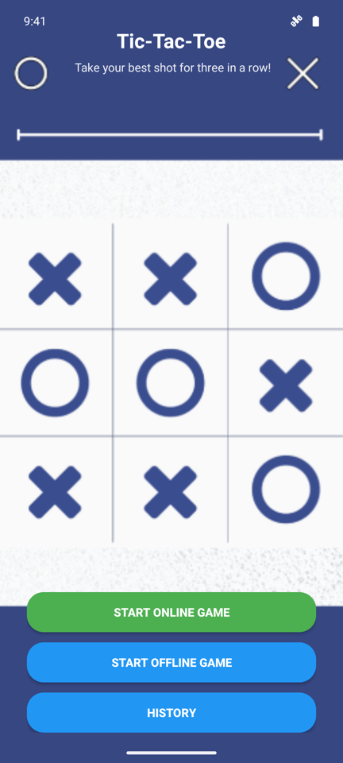
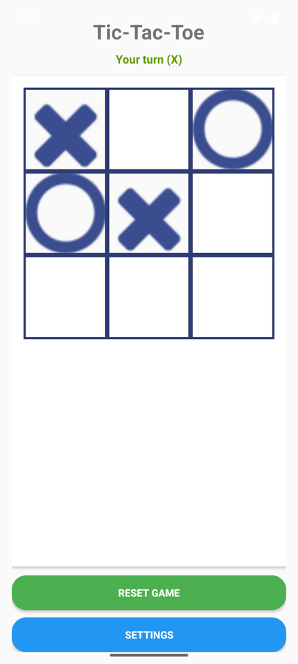
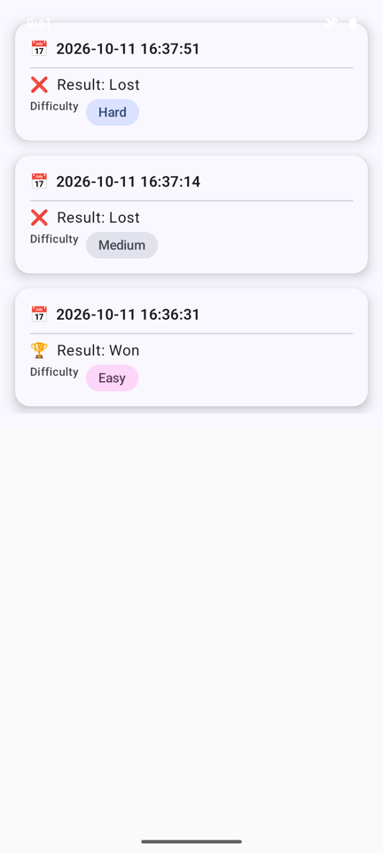
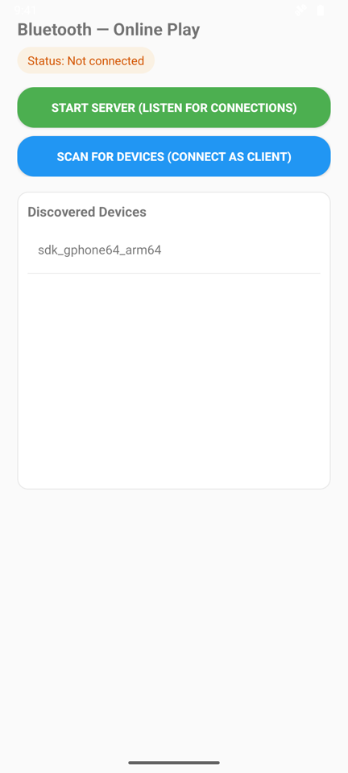
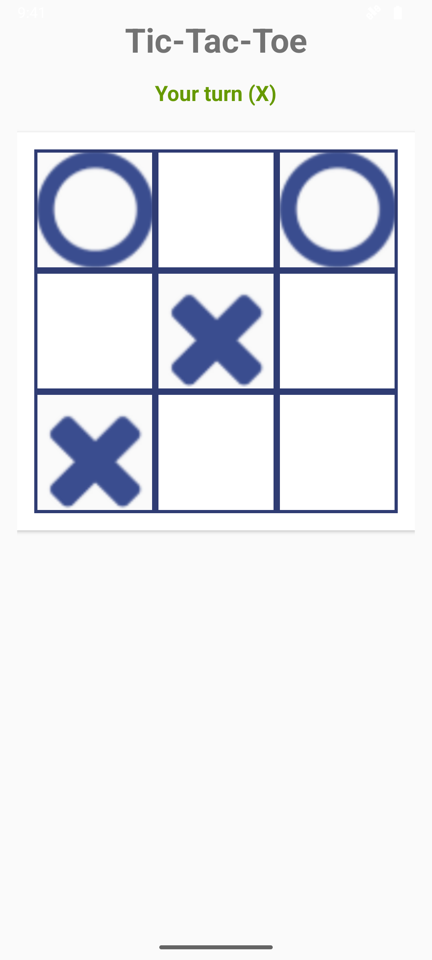
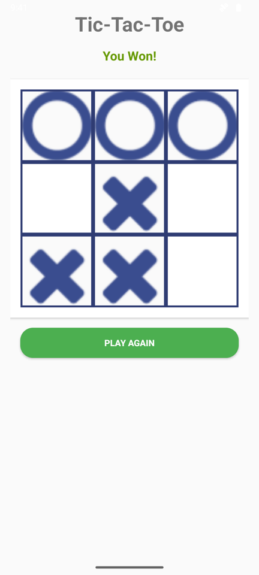

# Misère Tic-Tac-Toe

An Android Tic-Tac-Toe game with a twist: **if you get three in a row, you lose.**
Play head-to-head with a friend over **Bluetooth** or against an **AI opponent** with three difficulty levels. Every finished game is saved to a local history.

<p align="center">
  
  &nbsp;
  
  &nbsp;
  
</p>

## Features

- **Misère rules.** Classic 3×3 board, but completing a line ends the game in a loss for whoever made it.
- **Bluetooth multiplayer.** Two phones connect directly over Classic Bluetooth (RFCOMM). No internet or server needed. The host plays X and moves first.
- **AI opponent.**
  - *Easy*: plays random legal moves.
  - *Medium*: plays the optimal move 50% of the time, a random move otherwise.
  - *Hard*: minimax search with alpha-beta pruning, scored for misère rules (prefers forcing you into a line quickly and delaying its own).
- **Game history.** Results, difficulty and timestamps are stored with Room and shown in a Jetpack Compose list.
- **Resilient networking.** Handles dropped connections, repeated taps while connecting, out-of-order or malformed messages, and lets both players start a rematch.

## Online play

<p align="center">
  
  &nbsp;
  
  &nbsp;
  
</p>

1. On both phones, tap **Start Online Game** and allow Bluetooth access and discoverability.
2. On one phone, tap **Start Server**. This phone hosts and plays **X**.
3. On the other phone, tap **Scan for Devices** and pick the host from the list. This phone plays **O**.
4. The game starts on both phones automatically. When it ends, either player can tap **Play Again**.

Moves are sent as small newline-delimited text messages (`MOVE:row,col,symbol` and `RESET`) over the RFCOMM socket.

## Tech stack

| | |
|---|---|
| Language | Kotlin |
| UI | Android Views (game screens), Jetpack Compose + Material 3 (history) |
| Storage | Room (with KSP) |
| Networking | Android Bluetooth Classic, RFCOMM sockets |
| AI | Minimax with alpha-beta pruning |
| Min / target SDK | 26 / 36 |

## Project structure

```
app/src/main/java/com/example/bluetooth/
├── MainActivity.kt          # Home screen, Bluetooth discovery/pairing, server & client threads
├── GameActivity.kt          # Online game: board, turn handling, message protocol
├── OfflineGameActivity.kt   # Game against the AI, difficulty settings
├── HistoryActivity.kt       # Compose screen listing past games
├── AppDatabase.kt / PastGame.kt / PastGameDao.kt   # Room database
└── ai/
    ├── MoveGenerator.kt     # Picks a strategy based on difficulty
    ├── AiMoveGenerator.kt   # Minimax + alpha-beta (misère scoring)
    └── RandomMoveGenerator.kt
```

## Building and running

Requirements: Android Studio Narwhal (2025.1.3) or newer.

```bash
git clone https://github.com/ananya2914/Misere-Tic-Tac-Toe.git
cd Misere-Tic-Tac-Toe
./gradlew assembleDebug
```

Or open the project in Android Studio and press **Run**.

Online play needs **two devices with Bluetooth**, both running the same build. Two Android emulators (API 33+) on the same computer also work, since they share a virtual Bluetooth network.

## Credits

Built as a team project for CSE 535 (Fall 2025). My work included the game screen UI for online and offline play, the settings and difficulty picker, and later fixes for Bluetooth connection reliability and several crashes (including a crash whenever a game against the AI ended in a draw).
